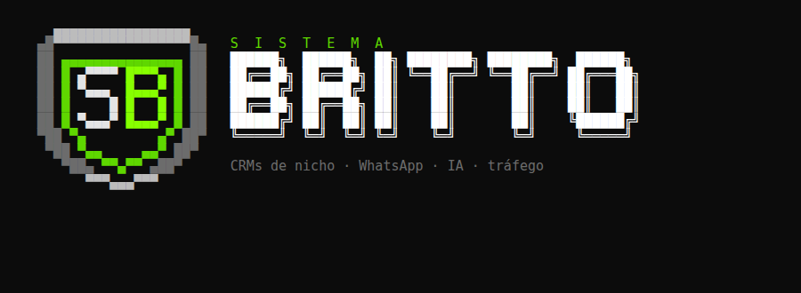

<p align="center"></p>

# Britto Wizard

Instalador de **CRMs de nicho** com WhatsApp, agentes de IA, funil de tráfego e conector MCP, em uma VPS **Ubuntu 24.04**. Começa pelo **evo-jud-crm** (escritórios de advocacia).

Fork do [SetupOrion](https://github.com/oriondesign2015/SetupOrion) (MIT) da **OrionDesign**: a estrutura, o Traefik + Portainer e o deploy de stacks pela API do Portainer vêm de lá. Os scripts originais (`Setup`, `SetupOrion`, `README-SetupOrion.md`) continuam neste repositório e seguem sincronizados. Créditos à OrionDesign.

## Instalar
```bash
sudo -i
bash <(curl -sSL https://raw.githubusercontent.com/sistemabritto/britto-wizard/main/britto)
```
O wizard abre com a logo do Sistema Britto, atualiza o servidor e instala as dependências, Docker e Swarm. Depois segue direto pelos passos, sem menu:

1. **Traefik + Portainer**, com HTTPS automático e admin criado sozinho.
2. **Qual CRM:**

   | CRM | Nicho | Situação |
   |---|---|---|
   | `evo-jud-crm` | jurídico | disponível |
   | `evo-clinic-crm` | clínicas | em breve |
   | `evo-store-crm` | lojas | em breve |
   | `evo-delivery-crm` | delivery | em breve |
   | `evo-service-crm` | serviços online | em breve |

3. **Instalação:**
   - bancos, CRM completo e WhatsApp;
   - **primeira conta**;
   - **template do nicho**: pipelines, etiquetas, campos, macros, opt-out e funil de tráfego;
   - fechamento do cadastro público.
4. **Extras:** conector **MCP** (Claude, ChatGPT/Codex) e **DocuSeal** (assinatura).

Depois: `britto-wizard status | template | fechar | mcp | docuseal | resumo`. Para validar sem instalar: `BRITTO_DRY_RUN=1 britto-wizard`.

**VPS:** 4 vCPU, 8 GB de RAM e 80 GB de disco. Funciona em CPU **sem AVX2**, como os Xeon E3 v2 da Database Mart, porque as versões estão fixadas por digest (`crm/*/images.env`).

## Testes
- **Instalação real** (sem dry-run), em Ubuntu 24.04 limpo com Docker Swarm, pelo comando `curl` oficial:
  - atualização do sistema, Docker, Swarm, Traefik e Portainer (admin criado com o setup token);
  - pgvector e Postgres publicados pelo Portainer, com os 4 bancos;
  - Evolution Go no ar via Traefik.

  Rodou com `BRITTO_TESTE_LEVE=1`, sem a stack do CRM (~9 GB de imagens). A configuração do CRM é a mesma que roda em produção.
- **Template jurídico:** aplicado num CRM real dentro de uma transação desfeita, sem deixar registro.
- **Skill do site:** gerado, testado no Chrome (código G/Meta, contagem de cliques) e publicado em repositório privado de exemplo.
- **Ativação do Evolution Go:** numa instalação nova, ative uma vez em `https://whatsapp.seudominio/manager`. Antes disso a API responde `LICENSE_REQUIRED` (guia 02).

## Teste automático
O workflow [`teste-instalacao`](.github/workflows/teste-instalacao.yml) roda a instalação **completa** do evo-jud-crm numa VM Ubuntu 24.04 descartável do GitHub. Ele usa o comando oficial e [respostas pré-definidas](tests/respostas-completo.txt). Depois, [`tests/verificar.sh`](tests/verificar.sh) confere:
- os serviços;
- as rotas HTTPS;
- o cadastro público fechado;
- o template aplicado;
- as permissões dos arquivos.

Para rodar: aba **Actions › teste-instalacao › Run workflow**.

## O que vem no evo-jud-crm
| Componente | Repositório / imagem |
|---|---|
| API do CRM (tracking, automações, pipelines) | [sistemabritto/evo-jud-crm-api](https://github.com/sistemabritto/evo-jud-crm-api) |
| Painel do CRM (Tráfego, Tracking, Dashboard Apps) | [sistemabritto/evo-jud-crm](https://github.com/sistemabritto/evo-jud-crm) |
| WhatsApp (pool compartilhado, vídeo, histórico) | [sistemabritto/evogo-jud](https://github.com/sistemabritto/evogo-jud) |
| Conector MCP (OAuth, funil, Asaas, DocuSeal, monitor jurídico) | [sistemabritto/evocrm-mcp](https://github.com/sistemabritto/evocrm-mcp) |
| Auth, core, processor, gateway, bot runtime, evoflow | imagens oficiais da Evolution Foundation, fixadas por digest |
| Patch do processor (áudio e anexos sem legenda nos agentes) | `crm/evo-jud-crm/processor-patch/` |
| DocuSeal, pgvector, Postgres, Redis, ClickHouse 26.3, RabbitMQ | imagens oficiais, fixadas |

## Materiais
[`docs/`](docs/README.md) traz os guias:
- conexões de WhatsApp, Instagram, Facebook e Gmail;
- agentes de IA, ações de inatividade, jornadas com gatilho de pipeline e campanhas;
- MCP no Claude Code e no Codex;
- tokens de pixel, API de Conversões e Google Ads para o painel `/trafego`.

A skill [`skills/site-trackeado`](skills/site-trackeado/SKILL.md) cria o site no GitHub já rastreado.

## Estrutura
```
britto                     comando de entrada (curl)
BrittoWizard               o wizard (TUI)
lib/                       logo ASCII e helper do Portainer
infra/                     Traefik + Portainer
crm/evo-jud-crm/           stacks, imagens, env.example, templates/, processor-patch/
docs/                      materiais
skills/site-trackeado/     skill do Claude Code para o site
```
Para um nicho novo, crie `crm/evo-<nicho>-crm/` com o mesmo formato e ative-o na lista `CRMS` do `BrittoWizard`.

## Licença
MIT, igual ao SetupOrion. Mantenha os créditos à OrionDesign e ao Sistema Britto.
